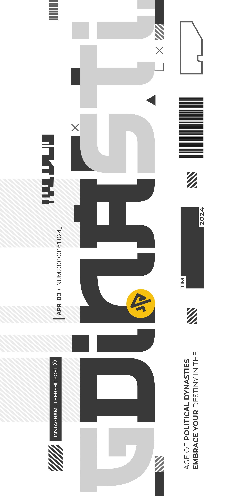
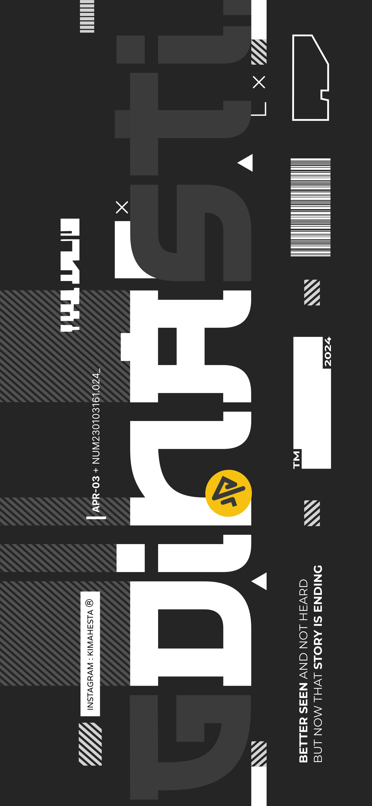

# GRA SKIN GDINASTI

**Generasi Dinasti** — Brand identity and visual design project.

## About

**GRA SKIN GDINASTI** is a design system exploring the concept of "Generasi Dinasti" (Generational Dynasty). The visual language combines contemporary aesthetics with symbolic elements representing generational legacy, growth, and continuity.

This project documents the core brand assets, visual guidelines, and identity components.

## Visual Assets

### Light Mode

*Light theme variant — clean, elevated presentation*

### Dark Mode

*Dark theme variant — high-contrast, immersive mode*

## Project Structure

- `Light.jpg` — Light theme mockup (273 KB)
- `Dark.jpg` — Dark theme mockup (315 KB)

## Design Philosophy

The **GRA SKIN** identity system is built around the tension between heritage and innovation. Key visual motifs include:

- Vertical typographic composition
- Alternating light/dark color schemes
- Generational symbolism embedded in geometry and spacing
- Balanced contrast between elements

## Usage

These assets are intended for brand documentation, presentation materials, and design system references. Each mockup demonstrates the adaptability of the GDINASTI identity across light and dark interfaces.

---

*Initialized for Generasi Dinasti brand project*